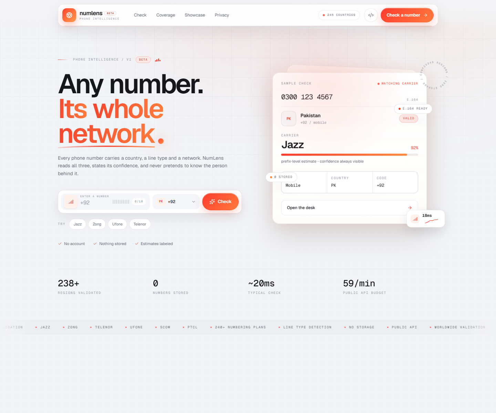

# NumLens

**Know any phone number's network - without turning it into a people search.**

NumLens validates a number against official numbering-plan metadata and tells you what the network can actually reveal: country, exact line type, clean E.164 formatting and a carrier estimate with a visible confidence score.

[](LICENSE)




## What it does

- **Worldwide validation** - 245 countries and regions from libphonenumber metadata, including length and check digits.
- **Exact line type** - mobile, landline, VoIP, toll free, premium rate, pager, UAN and more.
- **Carrier estimate** - prefix-level network with a confidence score, source label and portability warning.
- **Clean output** - E.164, international and national formats ready to copy.
- **Public API** - one JSON endpoint, 60 lookups/minute per IP, no key required.
- **Stateless** - numbers are processed in memory and never written to disk.

## The interface

A light "ember" desk built around one job - checking a number fast.

- **Animated hero** - word-by-word headline reveal, sweeping gradient type, orbiting badge and a live sample card with a confidence bar that fills as it mounts.
- **Typing that reacts** - the number field auto-groups digits, shows a 10-segment signal meter, flashes a gradient underline per keystroke and reports validity inline.
- **Searchable country dropdown** - all 245 countries with dial codes, keyboard search, animated list and a portal-rendered panel so it never clips or hides behind other sections.
- **Pinned scroll scene** - format, network and privacy cards drift at different speeds while the section stays pinned; no navigation required.
- **Honest results** - confidence is always shown, carrier estimates are labelled, and portability is explained instead of hidden.

Motion respects `prefers-reduced-motion`; every animation degrades to a static layout.

## What it never does

- No owner names, CNIC, addresses or linked accounts.
- No live location or tracking, because that data is not in a number.
- No stored lookup history, no accounts and no SMS.

Anything advertised as "live location from a phone number" is a scam. NumLens stays on the side of network facts.

## Stack

| Layer    | Choice                                                   |
| -------- | -------------------------------------------------------- |
| UI       | React 19, Vite 8, Tailwind CSS 4, lucide-react           |
| API      | Hono on Node, plus a Vercel function for serverless use  |
| Parsing  | libphonenumber-js (max metadata)                         |
| Tooling  | TypeScript 5.9, oxlint, tsx, concurrently                |
| CI       | GitHub Actions - lint + typecheck + production build     |

```
server/        Hono API, lookup engine, carrier dataset
api/           Vercel serverless entry point
src/           React app, design tokens, API client, country data
public/        favicon and static assets
docs/          README screenshots
```

## Run it

```bash
npm install
npm run dev
```


Production:

```bash
npm run build
npm start
```

Other scripts: `npm run lint`, `npm run check`.

## API

```bash
curl "http://localhost:8787/api/lookup?number=%2B923001234567"
```

```json
{
  "valid": true,
  "e164": "+923001234567",
  "formats": {
    "international": "+92 300 1234567",
    "national": "0300 1234567"
  },
  "country": { "iso": "PK", "name": "Pakistan", "flag": "PK", "callingCode": "92" },
  "lineType": { "code": "MOBILE", "label": "Mobile" },
  "carrier": {
    "name": "Jazz",
    "confidence": 0.92,
    "confidencePct": 92,
    "source": "prefix-dataset"
  },
  "portable": true,
  "source": "libphonenumber",
  "policy": { "storesNumbers": false, "ownerLookup": false, "signupRequired": false },
  "checkedAt": "2026-11-19T12:00:00.000Z",
  "durationMs": 18
}
```

Endpoints:

| Method | Path                      | Purpose                          |
| ------ | ------------------------- | -------------------------------- |
| GET    | `/api/lookup?number=`     | Validate and inspect a number    |
| POST   | `/api/lookup`             | Same, with `{ number, country }` |
| GET    | `/api/coverage`           | Carrier coverage and provider    |
| GET    | `/api/health`             | Liveness check                   |

Optional `country` hint (ISO2) helps when the number has no `+` code. Responses include rate-limit headers.

## Coverage, honestly

Validation, formatting, country and line type are exact worldwide.

Carrier names are **prefix-level** and currently mapped for Pakistan:

| Prefix        | Network | Confidence |
| ------------- | ------- | ---------- |
| 300-309       | Jazz    | 92%        |
| 310-319       | Zong    | 92%        |
| 320-329       | Jazz    | 92%        |
| 330-339       | Ufone   | 92%        |
| 340-349       | Telenor | 92%        |
| 350-359       | SCOM    | 62%        |
| 370-379       | Jazz    | 62%        |
| 388           | Ufone   | 55%        |

Number portability means the carrier can differ from the original allocation, so the UI always shows confidence and never hides the source.

For live worldwide carrier data, set a provider key on the server:

```bash
NUMVERIFY_ACCESS_KEY=your_key_here
```

The adapter calls numverify server-side (`server/lookup.ts`). Keys are never sent to the browser, never committed and never logged. See `.env.example`.

## Privacy

- No database and no numbers table.
- `Cache-Control: no-store` on every lookup.
- Rate limiting in memory by IP.
- No analytics, no cookies, no accounts.

## Deploy

Vercel detects Vite via `vercel.json`; `api/lookup.ts` runs as a serverless function and the SPA is served from `dist`. The project targets Node 22 (`.nvmrc`). Set `NUMVERIFY_ACCESS_KEY` in project environment variables if you want live carrier lookups.

## Roadmap

- OTP ownership verification badge for your own number.
- Bulk CSV checks with a downloadable report.
- Twilio Lookup adapter alongside numverify.
- Prefix datasets for more countries.

## License

MIT - see [LICENSE](LICENSE).
